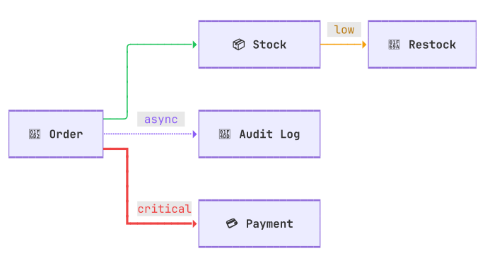

# @tayomi/mermaid2term

[](https://www.npmjs.com/package/@tayomi/mermaid2term)
[](https://nodejs.org)
[](https://www.typescriptlang.org)
[](LICENSE)

**Mermaid diagrams, drawn in your terminal.**

<picture>
  <source media="(prefers-color-scheme: dark)" srcset="docs/images/hero-dark.svg">
  
</picture>

*Drawn by mermaid2term from [`docs/images/hero.mmd`](docs/images/hero.mmd), turned into an SVG by [@tayomi/term2svg](https://github.com/mopi1402/term2svg).*

## Features

**✨ 18 diagram kinds.**  
Flowchart, sequence, class, state, ER, gantt, git graph, journey, kanban, mindmap, packet, pie, quadrant, timeline, treemap, xy chart, architecture, block.

**✨ Mermaid's own syntax and themes.**  
Its syntax and config keys, its 11 themes, and a light-terminal mirror of each.

**✨ Fits the width you give it.**  
The drawing is redrawn tighter as far as it can go, never squeezed out of shape. Past that, the command says so.

**✨ Zero dependency.**  
Rewritten from scratch, Node 22 alone. mermaid pulls in 110 packages.

## Try it

The [playground](https://mermaid2term.vercel.app) draws the source you type beside mermaid's own rendering, nothing to install.

## Install

```sh
npm install @tayomi/mermaid2term
```

## Use

```sh
mermaid2term diagram.mmd --width 100 --theme forest
echo 'graph LR; A-->B' | mermaid2term
```

```ts
import { render } from "@tayomi/mermaid2term";

console.log(render("graph LR; A-->B", { width: 80 }));
```

`mermaid2term --help` lists every option.

Where a drawing departs from mermaid on purpose, the reason is in [docs/divergences.md](docs/divergences.md).

## Licence

MIT, see [LICENSE](LICENSE).
